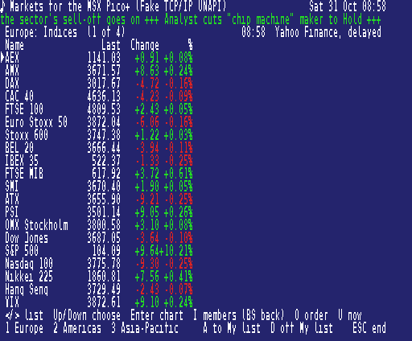
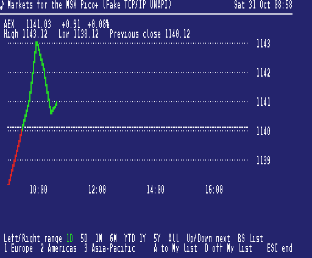

# MSX Markets Monitor

A live market monitor for the MSX in one 16 KB ROM: index, currency, commodity and crypto prices from Yahoo Finance, day and history charts, the members of the main indices, your own watch list and a scrolling headline tape. It runs on the **MSX Pico+** cartridge, which gives it its Wi-Fi.

| The table | A day chart |
|---|---|
|  |  |

*(Emulator screenshots with sample data.)*

## Where the magic comes from: PicoAmp

This is the market monitor of **[PicoAmp](https://github.com/Jzzy-dev/msx-picoplay-picoamp)**, taken out on its own. In PicoAmp, on the PicoVerse 2350 cartridge, the RP2350 does the hard work (the network, the JSON, the numbers, the charts) and the MSX only draws the page. Its look, its screen code (`src/markets.asm` is PicoAmp's page), its lists of markets and the way it reads Yahoo are all PicoAmp's.

For MKTW, PicoAmp's engine was rewritten in Z80 assembly, so the MSX does all the work itself:

- **Numbers:** 32-bit arithmetic with 64-bit products and quotients, prices kept as scaled integers (`mkmath.asm`, `mknum.asm`).
- **Yahoo's answers:** a JSON reader that works on the data as it streams in (`mkeng2.asm`).
- **The pages:** prices, charts, the members lists, the tape and the sorting (`mkeng.asm`, `mkeng2.asm`, `mkeng3.asm`).

The network side, HTTP and TLS through the TCP/IP UNAPI, is the client of the [MSX RSS reader](https://github.com/Jzzy-dev/msx-rss-reader) (`rss_net.asm`, `rss_sys.asm`, `rss_date.asm`). So is the way the ROM gets the Pico+'s Wi-Fi.

## What you need

- An MSX2 (it uses SCREEN 6, 512×212) with an **MSX Pico+** cartridge, firmware 2.13 or later, with Wi-Fi set up.
- An SD card with MKTW.ROM and MARKETS.CAT on it.

## Starting it

1. Copy `MKTW.ROM` and `MARKETS.CAT` to the SD card, in the same folder.
2. Start MKTW.ROM from the Pico+ menu's SD browser. The menu loads it in its **WIFI+Telnet** mode, because the file is exactly 16 KB and contains "UNAPI". That mode puts the Pico+'s Wi-Fi BIOS in the slot, and it is the only way a ROM can reach the ESP8266. (The ROM also sets USRTAB at INIT, so Nextor starts Disk BASIC 2 and FAT16 SD cards work.)
3. Once the disk is ready, the loader unpacks the 24 KB program into the RAM of pages 1 and 2, through VRAM, and runs it.

ESC ends it and gives you BASIC with an empty program.

## Keys

| Key | |
|---|---|
| 1 2 3 | Region: Europe, Americas, Asia-Pacific |
| ← → | The region's lists (Indices; Currencies, commodities, rates; AEX; DAX; ...) and My list |
| ↑ ↓ | Choose a row |
| Enter | Chart of the chosen row; ← → change the range (1D 5D 1M 6M YTD 1Y 5Y All), ↑ ↓ the next row, BS back to the list |
| I | The members of the chosen index (from MARKETS.CAT); BS back |
| O | The order: as listed, risers first, fallers first |
| U | Update now |
| A | Add the chosen row to My list (from any list, members too) |
| D or DEL | On My list: remove the chosen row |
| ESC | End (saves MARKETS.INI) |

## The headline tape

Row 2 scrolls Yahoo's news headlines. It changes topic every 2 minutes, in this order:

1. The region's index (^STOXX50E, ^GSPC, ^N225)
2. EUR/USD
3. Gold
4. US 10-year yield
5. The biggest mover in the list you have open

The next topic's headlines load while the current tape scrolls. If a request fails, the row says why, with its network error and HTTP status.

The headlines come from Yahoo's search API on query1.finance.yahoo.com, the same host as the prices. Yahoo's RSS feeds send EU visitors to a cookie-consent page.

## MARKETS.INI

This file is optional, and it is kept next to the ROM. MKTW writes `region=` and `list=` back when you press ESC; your other lines stay as they are. See `MARKETS.INI.sample`.

| Setting | Example | Meaning |
|---|---|---|
| `region=` | `europe` | The region at start: `europe`, `americas` or `asia` |
| `list=` | `ASML.AS,AAPL,BTC-EUR,EURUSD=X` | My list: up to 40 Yahoo symbols, separated by commas, semicolons or spaces |
| `refresh=` | `60` | Seconds between price updates (20–3600, default 60) |
| `tz=` | `+60` | Your time zone in minutes from UTC. Without it, MKTW works it out from the MSX clock and the server's time. |
| `proxy=` | `10.0.0.2:8088` | An HTTP proxy, host:port |

## MARKETS.CAT

These are the members of the main indices (AEX, DAX, CAC 40, FTSE 100, S&P 500, Nikkei 225, ...): 15 indices, about 14 KB. They are read from the SD card when you press I, to keep them out of the ROM. The file is made from PicoAmp's list of markets:

```
python3 src/gen_cat.py <PicoAmp>/engine/pva_markets_cat.c src/mk_cat.inc MARKETS.CAT
```

That also rebuilds `src/mk_cat.inc`, the regions and their lists, which are in the ROM.

## Building

You need [sjasmplus](https://github.com/z00m128/sjasmplus) and [ZX0](https://github.com/einar-saukas/ZX0) v2.2.

```
./build.sh
```

This makes `src/mktw.bin` (the program, assembled at 4000h), packs it to `src/mktw.zx0` (about 15.9 KB), and assembles the loader `src/mktwl.asm` with it into `MKTW.ROM`, which must be exactly 16,384 bytes. The ROM has 35 bytes to spare at the moment.

| File | |
|---|---|
| `mktw.asm` | The start (ROM header, INIT, H.STKE), memory layout, includes |
| `mktwl.asm` | The 16 KB loader: INIT, H.STKE, unpacking through VRAM, the ZX0 decoder |
| `markets.asm` | PicoAmp's page: the table, the charts, the keys |
| `mkframe.asm` | What the page needs from PicoAmp's frame: palette, font, commands, MARKETS.INI, the main loop |
| `mkeng.asm` | The engine: lists, rows, sorting, commands, requests, My list |
| `mkeng2.asm` | Yahoo's JSON (prices and charts), the chart's columns and scales |
| `mkeng3.asm` | The chart's time axis, the headline tape, the disk (MARKETS.CAT, MARKETS.INI) |
| `mkmath.asm`, `mknum.asm` | 32/64-bit arithmetic, number parsing and formatting |
| `rss_*.asm` | From the MSX RSS reader: system, dates, HTTP/TLS over the TCP/IP UNAPI |
| `mk_cat.inc` | The regions and lists (made by `gen_cat.py`) |

## Tests

`test/run.sh` builds the test programs and runs them. It needs gcc, Python 3 with Pillow, and the Z80 core from [superzazu/z80](https://github.com/superzazu/z80) (`z80.c`, `z80.h`) in `test/z80/` or in `$Z80`.

- **`test_math.py`, `test_num.py`** check the arithmetic and number formatting against Python, with random values.
- **`test_rssw`** runs the loader on an MSX2 and an MSX1 with an expanded slot like the Pico+'s. It checks that the program is unpacked byte for byte, runs from RAM, and that BASIC gets its pages back.
- **`z80_mk`** runs the program on an emulated MSX with a fake TCP/IP UNAPI that answers like Yahoo (sample prices, charts and news), and saves the screen for `scr6png.py`. The program image must have a `.ROM` name:

  ```
  cp src/mktw.bin /tmp/MKTW.ROM
  mkdir -p test/ini && cp MARKETS.CAT test/ini/
  cd test && MK_RAM=1 ./z80_mk /tmp/MKTW.ROM fix ini "......2" 20 out.vram && python3 scr6png.py out.vram out.png
  ```

  Keys start after 4 s, one every 0.5 s. `.` waits, `^` is Enter, `<` `>` `{` `}` are the arrows, `_` is BS, `~` is ESC. `MK_NEWS404=1` makes the news fail.

## Notes

- **The data:** prices come from Yahoo Finance's unofficial API (no key) and are delayed. They are not for trading.
- **Licence:** like PicoAmp and the PicoVerse project, this is licensed under [Creative Commons Attribution-NonCommercial-ShareAlike 4.0](LICENSE.txt).
